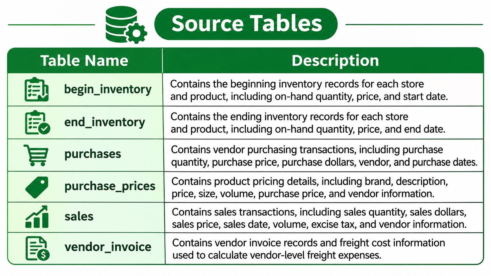
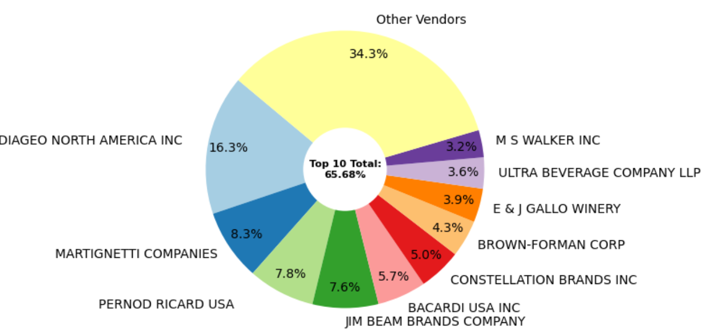
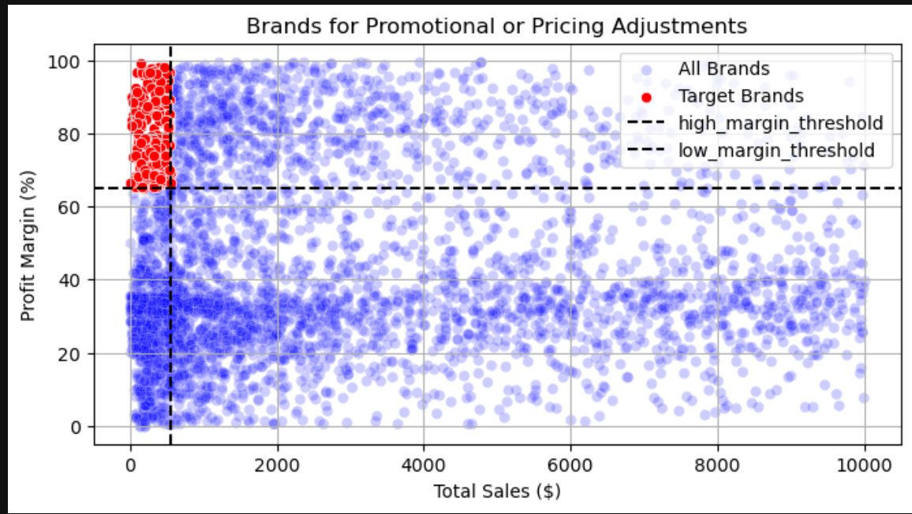

### Inventory-Vendor-Performance-Analysis-Python-SQL
### Background and Overview

#### Project Overview

##### The Vendor Performance Analysis project focuses on evaluating vendor performance, purchasing patterns, sales performance, profitability, and inventory efficiency using data analysis.
##### The data is distributed across multiple tables, making it difficult to analyze vendor performance directly. To solve this, SQL queries are used to combine purchasing, sales, product pricing, and freight information into a consolidated vendor summary table.
##### Python is then used for data cleaning, exploratory data analysis (EDA), statistical analysis, and visualization to identify important business insights and support better procurement decisions.

#### Business Objectives:

##### 1) Evaluate vendor and brand sales performance.
##### 2) Identify vendors contributing the most to total procurement.
##### 3) Analyze profitability and profit margins.
##### 4) Understand the impact of bulk purchasing on unit prices.
##### 5) Identify slow-moving products and vendors with low inventory turnover.
##### 6) Estimate the capital locked in unsold inventory.
##### 7) Identify brands with low sales but high profit margins that may benefit from promotional activities.

#### Tools and Technologies:

##### Python: Data cleaning, analysis, and visualization.
##### Pandas & NumPy: Data manipulation and numerical analysis.
##### SQL & SQLite: Data extraction, aggregation, joins, and storage.
##### Matplotlib & Seaborn: Data visualization.
##### SciPy: Statistical analysis.
##### Jupyter Notebook: Development and analysis environment.

### Data Structure Overview:

  

### Data Processing:
##### The source tables are combined using SQL Common Table Expressions (CTEs) and JOIN operations.

##### Three summary sections are created:

##### Purchase Summary: Aggregates purchase quantity and purchase dollars by vendor and brand.
##### Sales Summary: Aggregates sales quantity, sales dollars, sales price, and excise tax by vendor and brand.
##### Freight Summary: Calculates total freight cost for each vendor.

##### These summaries are combined with product pricing information to create the final vendor_sales_summary table.

#### Key Columns in the Final Summary Table:
##### VendorNumber, VendorName, Brand, Description, PurchasePrice, ActualPrice, Volume, TotalPurchaseQuantity, TotalPurchaseDollars, TotalSalesQuantity, TotalSalesDollars, TotalSalesPrice, TotalExciseTax, FreightCost

### Executive Summary:

##### The analysis focuses on vendor contribution, sales performance, profitability, purchasing efficiency, and inventory management.

##### The major findings include:

##### 1) The top 10 vendors contribute approximately 65.69% of total purchase value, indicating a significant dependence on a relatively small group of vendors.
##### 2) Bulk purchasing is associated with lower unit purchase prices. Large orders have an average unit purchase price of approximately $10.78 in the notebook analysis.
##### 3) The analysis identifies brands with relatively low sales but high profit margins that may be suitable for promotional activities.
##### 4) Some vendors demonstrate low stock turnover, indicating potentially slow-moving inventory.
##### 5) Unsold inventory represents capital tied up in products that have been purchased but not yet sold.

### Insights Deep Dive:
##### 1. Which vendors contribute the most to total purchases?

  

##### 2. Which brands have low sales but high profit margins, indicating potential opportunities for promotional activities?

  

### Recommendations
##### 1. Optimize Procurement and Vendor Management
##### - Strengthen relationships with high-contributing vendors.
##### - Negotiate better prices through bulk purchasing.
##### - Diversify suppliers to reduce vendor dependency.

##### 2. Improve Inventory and Working Capital Management
##### - Monitor slow-moving inventory and vendors with low stock turnover.
##### - Reduce excess inventory to minimize capital blockage.
##### - Use historical sales trends to plan future purchases.

##### 3. Focus on Profitability and Sales Growth
##### - Promote low-sales, high-margin brands through targeted campaigns.
##### - Monitor vendor-wise sales and profit margins regularly.
##### - Use data-driven insights to improve pricing and business decisions.

